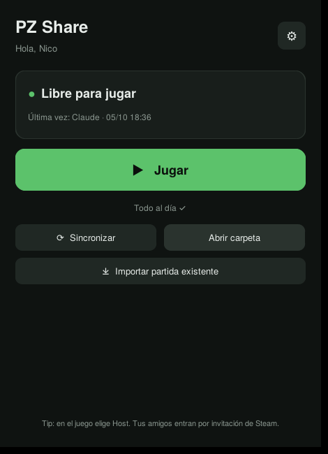

# PZ Share

App de escritorio para compartir una partida de **Project Zomboid** entre amigos sin servidor dedicado.
Cualquiera hace *Host* desde su PC; la partida vive en un repo privado de GitHub y la app la baja antes de jugar y la sube al cerrar el juego.

## Qué hace (y qué no)

Todo está en un solo archivo: [`pz_share.py`](pz_share.py) (~730 líneas, Python + customtkinter).
Lo único que ejecuta fuera de sí misma (busca `subprocess`, `os.startfile` y `webbrowser` en el código):

- `git` (clone, pull, commit, push) sobre la carpeta de la partida que tú eliges.
- Steam, para abrir el juego: `steam.exe -applaunch 108600 -cachedir=<tu carpeta>`.
- `tasklist`, para saber si `ProjectZomboid64.exe` sigue abierto y subir la partida al cerrarlo.
- El Explorador de Windows (botón *Abrir carpeta*) y el navegador (botón *Descargar Git*).

Además:

- *Importar partida existente* copia archivos de `%USERPROFILE%\Zomboid` a la carpeta de la partida.
- Crea `host.lock` con tu nombre para avisar a los demás que estás jugando.
- Guarda su configuración (nombre, repo, carpeta) en `%APPDATA%\PZShare\config.json`.
- **No** guarda contraseñas ni tokens: el login de GitHub lo maneja Git Credential Manager (el de Git para Windows).
- **No** se conecta a ningún servidor propio: solo a GitHub, a través de git.
- **No** sube ajustes personales: el `.gitignore` solo deja pasar `Server/`, `Saves/Multiplayer/` y `db/`.

## Usarla

Requisitos: [Git para Windows](https://git-scm.com/download/win) y [Python 3](https://python.org/downloads) (marcar *Add to PATH*).

| Opción | Cómo |
|---|---|
| Ejecutar con Python | Doble clic en `ejecutar.bat` |
| Generar tu propio .exe | Doble clic en `crear_exe.bat` → `dist\PZ Share.exe` |

Primera vez: tu nombre, link del repo de la partida y una carpeta **vacía** → *Conectar*.

## Reglas de la partida

- Abrir siempre el juego desde **Jugar** en PZ Share.
- Todos con la misma versión del juego y los mismos mods.
  La lista de mods viaja con la partida (`Server/*.ini`), pero los archivos de los mods no:
  cada jugador debe estar suscrito en Steam. El botón **Mods de la partida** cruza `Mods=` y
  `WorkshopItems=` con lo instalado en tu PC y muestra qué falta, qué está activo y qué no
  (con botón para abrir en Steam los mods que faltan). **Jugar** avisa si te faltan mods.
- Un solo host a la vez (la app avisa si alguien ya está jugando).

## Extras

- **Unirse**: si otro está hosteando, la app abre el juego y tu lista de amigos de Steam para entrar a su partida.
- **Historial**: últimas sesiones en la pantalla principal y, en *Ver todo*, quién ha jugado más y cuánto (sale de los commits).
- **Mods con vista previa**: cada mod de la partida sale como tarjeta con imagen, descripción, suscriptores y si es de B42 (datos públicos de Steam). Filtra por *Me faltan* / *Instalados*, suscríbete uno por uno o a todos los que faltan.
- **Pack de mods del grupo** (opcional): en *Mods de la partida* pega el link de una Colección del Workshop; se guarda en `pzshare.json` y todos ven el botón para suscribirse a todo con un clic.
